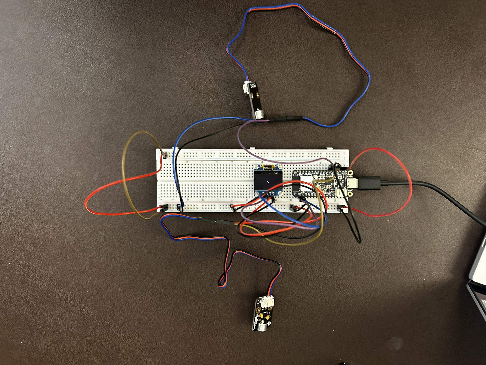

### Adewola Orogade
## Week 10/11

* 10/12 - I met with my team members to continue working on our Verification & Validation Plan Assignment.  

This are the meeting minutes for our meeting:  
*We met in Glennan lab on Monday, October 12, 2026, at 2:00 PM. All members were present.
We discussed the possibility of revising our prototype with Professor Fu, opening us up to the potential of revising our prototyping strategy for better-paced prototypes, rather than potentially making big leaps from one prototype to another.
Martin and Aryan continued to write Verification and Validation Protocols.
Adewola wrote out considerations for risks & safety, as well as contributing to both tracing matrices.
Andrew finished writing the verification strategy/justification and began developing verification testing protocols for each technical spec.
Adjourned at 3:00 PM.*  

I worked on explaining the risks, safety, and ethics related to the use of our system and outlining the protocols of our Verification Tracing Matrix and Validation Tracing Matrix.

* 10/14 - I met with my team members to continue working on our Prototype Stage 2.   

This are the meeting minutes for our meeting:  
*We met in Glennan lab on Wednesday, October 14, 2026, at 2:05PM. All members were present.
We received our microphones today, so we began making preparations to test them.
Andrew soldered some breakout pins to the Adafruit I2S Mic (http://adafru.it/6049). Meanwhile, Aryan, Adewola, and Martin began testing the analog sound sensor (DFR0034: https://wiki.dfrobot.com/dfr0034/). 
The three members working on the sound sensor connected the sensor to the ESP32 and observed outputs to determine how the device works.
Aryan made a GitHub repo for the team so that we can easily work on shared files. Martin and Andrew each pushed the code that they had written for OLED & sensor testing. We created a folder to work on merging our code together for a revised prototype.
Aryan and Adewola began developing code to test the function of the buzzer.*  

Aryan, one of my team members, and I worked to look at how we could implement the passive buzzer module in our subsytem by testing its functionality - after distinct tests we discovered that we might be unable to utilize the buzzer component as the vibrating output of our system.

* 10/16 - I met with my team members to continue working on our Prototype Stage 2 and begin working on our Prototype Stage 3.  
 
These are my notes from our meeting with the stakeholder:  
*We met on Friday, October 16, 2026, at 2:00 PM, in Glennan Lab. All members were present.
We each worked on various parts of working with the individual components that will be used in our device. Martin worked on connecting the sound sensors to the OLED and displaying an image, while Aryan, Adewola, and Andrew worked on communicating with the microphone module.
We were successfully able to display an image on the OLED based on the signals from two sound sensors, establishing a baseline for the final goal of establishing an absolute direction by attaching more sensors.
We were also able to successfully get data from the microphone module, but we will need more testing to understand this data and work with it in real time for displaying appropriate signals on the screen.
Adjourned at 3:10 PM.*  

My team and I finalized the build of our Project's Prototype Stage 2 as can be seen below:
.

* 10/17 - I  met with my team members to continue working on our Prototype Stage 3.  

This are the meeting minutes for our meeting:  
*The meeting began on Saturday, October 17, at 3:00 pm. We met at the Glennan undergraduate laboratory. All team members were present.
At the beginning of the meeting, every team member picked up what they were working on in the previous meeting, yesterday. Andrew continued to work with his microphone and obtain frequencies from it, Adewola and Aryan continued to work on implementing the vibration subsystem, and Martin continued to work on the display and directional microphone subsystems and fix bugs in the code.
Adewola and Aryan have come to the decision to use the TT motor to simulate our vibration subsystem.
Martin has fixed a number of bugs and features for the display and microphone subsystems.
Andrew has experimented with the MEMS microphone and has found out numerous 
The team began to divide the work for the group presentation next week. We’ve divided the work to where Adewola works on the storyline, Andrew works on the functional and technical specifications, Martin works on the design overview, Aryan works on the design overview and all the team members will work on the evaluation plan.
The team also began to divide the work for the Prototype 1, 2, and 3 PDF. The work was divided with each prototype with Aryan working on explaining Prototype 1, Andrew working on explaining Prototype 2, Martin working on explaining Prototype 3, and Adewola working on connecting the verification and the validation plan.
Adjourned at 6:00 PM.*  

I 